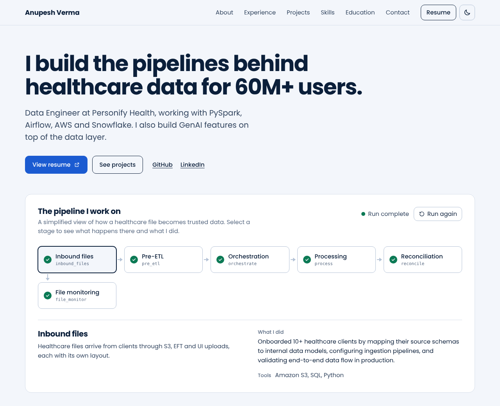

# Anupesh Verma: Portfolio

Portfolio site of Anupesh Kumar Verma, a data engineer building healthcare data pipelines. One fast page with a light and dark theme, no UI framework and no tracking.

**Live site:** https://anupeshverma.netlify.app

<picture>
  <source media="(prefers-color-scheme: dark)" srcset="docs/screenshot-dark.png">
  
</picture>

## What's on the site

- **An interactive pipeline in the hero.** The pipeline I work on, drawn as a task graph. It plays one simulated run on load, and selecting a stage shows what happens there and what I did.
- **A data flow for DineFlow.** My end-to-end data platform project, shown stage by stage: S3, the Snowflake Bronze, Silver and Gold layers, LLM enrichment, and the apps on top, with the Airflow task that runs each stage.
- **Experience, projects, skills, education and a contact form.** Every number and claim matches my resume.
- **Light and dark themes.** The site follows the system setting and remembers the visitor's choice.

## Built with

React 19, TypeScript and Vite, with plain CSS driven by design tokens. The only runtime dependencies are `react` and `react-dom`.

## Design decisions

- **Content lives apart from code.** All text and data are in [`src/content.ts`](src/content.ts), so updating the site never means touching a component.
- **Almost no dependencies.** No CSS framework, animation library or icon package. There is little to break or go out of date.
- **No trackers.** Fonts are subset and self-hosted, there are no analytics, and the only network request the page makes is sending the contact form.
- **One diagram component, two uses.** `FlowDiagram` draws both the hero pipeline and the DineFlow flow. It lays itself out by the width of its container (CSS container queries), left to right when there is room and as a vertical list when there isn't.
- **Accessible by default.** Full keyboard use, a skip link, visible focus, text colours checked against WCAG AA contrast in both themes, and no animation for visitors who prefer reduced motion.
- **No flash of the wrong theme.** A small inline script in `index.html` sets the theme before the first paint.
- **Search and sharing.** Page title and description, Open Graph tags for link previews, JSON-LD structured data, a sitemap and `robots.txt`.

## Run it locally

Requires Node 20.19 or newer (Node 22 recommended).

```bash
npm install
npm run dev        # http://localhost:5173
npm run build      # production build into dist/
npm run preview    # serve the production build locally
npm run typecheck  # TypeScript check
```

Setup, editing and deployment are covered in [INSTRUCTIONS.md](INSTRUCTIONS.md).

## Project structure

```
index.html              page shell, SEO and link-preview tags, theme bootstrap
netlify.toml            build settings and cache headers
public/                 favicon, link-preview image, robots.txt, sitemap.xml
src/
  content.ts            all text and data
  App.tsx, main.tsx     app shell and entry point
  components/           one component and stylesheet per section
                        (FlowDiagram is shared by the hero and DineFlow)
  hooks/                theme and active-section logic
  styles/               design tokens and base styles
  assets/               self-hosted fonts and images
```

## Credits

Type: [Poppins](https://fonts.google.com/specimen/Poppins) (SIL Open Font License) and DejaVu Sans Mono, both subset and self-hosted.
